<p align="center">
  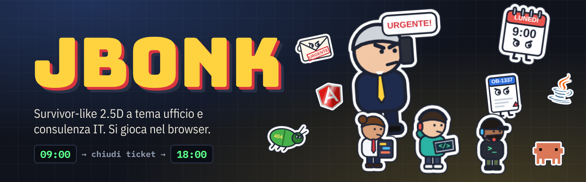
</p>

<p align="center">
  
  
  
  
  
  
</p>

<p align="center">
  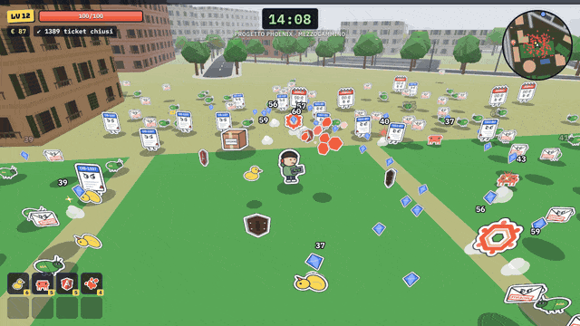
</p>

<p align="center">
  <a href="#avvio"><b>Avvio</b></a> ·
  <a href="#comandi"><b>Comandi</b></a> ·
  <a href="#il-loop-di-gioco"><b>Il loop di gioco</b></a> ·
  <a href="#la-mappa-mezzocammino-roma"><b>La mappa</b></a> ·
  <a href="#sprite-animati-e-loghi"><b>Loghi animati</b></a> ·
  <a href="#architettura"><b>Architettura</b></a> ·
  <a href="#come-aggiungere-un-progetto-bioma"><b>Estendere il gioco</b></a>
</p>

# JBonk — POC

Survivor-like in 2.5D sullo stile di PokeBonk/Megabonk, a tema ufficio e consulenza IT.
Gira nel browser, senza installazione per chi gioca.

Obiettivo del POC: dimostrare che il gioco **si può fare** con un web stack leggero.
Gli asset sono generati via codice e sono volutamente semplici.

## Avvio

```bash
npm install
npm run dev        # http://localhost:5173  (aggiungere #debug all'URL per le scorciatoie di test)
npm run build      # build di produzione in dist/ (un solo game.js)
npm run artifact   # build + artifact/ (pagina + game.js pronti da pubblicare su qualsiasi hosting statico)
```

## Comandi

| Tasto | Azione |
|---|---|
| WASD / frecce | Muoversi (relativo alla camera) |
| Mouse | Camera (clic sul gioco per bloccare il puntatore, oppure trascina) |
| Rotella | Zoom |
| Spazio | Salto (si scavalcano i nemici bassi) |
| Shift | Scatto con invulnerabilità |
| E | Interagire (forzieri, sala riunioni, totem NGH, JOscar, ascensore) |
| 1 / 2 / 3 | Scegliere una carta |
| Esc / P | Pausa |
| M | Audio on/off |

Da telefono o tablet compaiono i controlli touch (il gioco passa da solo a quelli touch al primo tocco e torna a tastiera e mouse quando si usa il mouse):

| Gesto | Azione |
|---|---|
| Pollice sinistro (metà sinistra dello schermo) | Joystick: nasce dove appoggi il dito, più lo spingi più corri |
| Trascinare un dito sulla metà destra | Camera |
| Due dita sulla metà destra | Zoom |
| Pulsanti **Salta** / **Scatto** | Salto / scatto (lo spicchio scuro sullo Scatto è la ricarica) |
| Pulsante **Usa** | Interagire: compare solo quando c'è qualcosa da usare |
| Pulsante pausa (sotto la minimappa) | Pausa; dal menu di pausa si accende e spegne l'audio |
| Tocco sulla carta | Scegliere una carta |

Si gioca meglio col telefono in orizzontale; in verticale il campo visivo si allarga e l'HUD si risistema.
All'avvio della partita il gioco chiede lo schermo intero dove il browser lo permette (non su iPhone né dentro un iframe):
su iPhone si ottiene aggiungendo la pagina alla schermata Home.

<p align="center">
  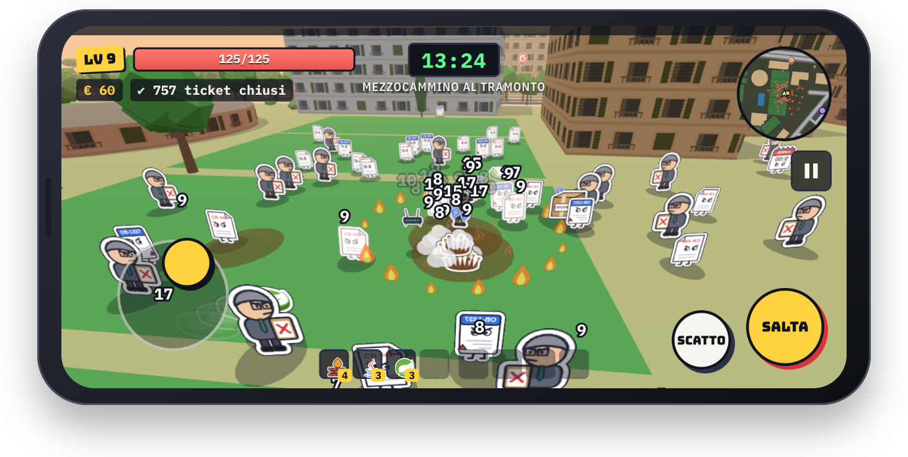
</p>

Con `#debug` nell'URL: `L` level-up, `B` boss, `G` invincibile, `K` uccidi tutti, `T` +1 ora, `O` +100 €, `N` nuova arma (prima le ultime aggiunte), `C` carta Soldo, `F` onda del radar NGH, `J` statuetta JOscar.

## Il loop di gioco

- **Giornata = livello.** Dalle 09:00 alle 18:00 (6 minuti reali). Le ondate crescono nel tempo, ci sono sciami a orari fissi e un "guardiano" (élite) ogni 80 s.
- **Level-up = promozione.** Si sceglie 1 tra 3 carte-ticket. La rarità è la priorità del ticket (Bassa → Bloccante) e scala il bonus.
- **Ordini d'acquisto** (forzieri): costano buoni pasto e danno una carta di rarità almeno Media. I guardiani ne lasciano uno gratis.
- **Macchinette del caffè** (santuari): restandoci vicino si ottiene un bonus permanente, a scelta tra 3 bevande.
- **Presidi GPI** (roll-up "The Healthcare Partner"): restandoci vicino si recuperano HP, fino a esaurire la scorta del presidio.
- **Carte Soldo**: le lasciano i guardiani, il boss e, raramente, i nemici normali. Raccolte, ricaricano il budget (buoni pasto).
- **Totem NGH** (eliminacode NextGenerationHIS, 2 per progetto): si usano una volta. L'onda del radar mette in "lista d'attesa" tutti i nemici che raggiunge: fermi e innocui per 6 secondi (il boss per 2). Cancella anche i proiettili dei boss.
- **Sala riunioni**: convoca il boss in anticipo. Alle 18:00 arriva comunque, e scatta lo straordinario.
- **Boss sconfitto → JOscar e ascensore.** Accanto all'ascensore compare la statuetta del JOscar: ritirandola parte la premiazione e si sceglie un premio (carte di rarità almeno Alta). La schermata finale conta i JOscar vinti. L'ascensore porta al progetto successivo; si vince consegnando 3 progetti.

<table>
  <tr>
    <td width="50%">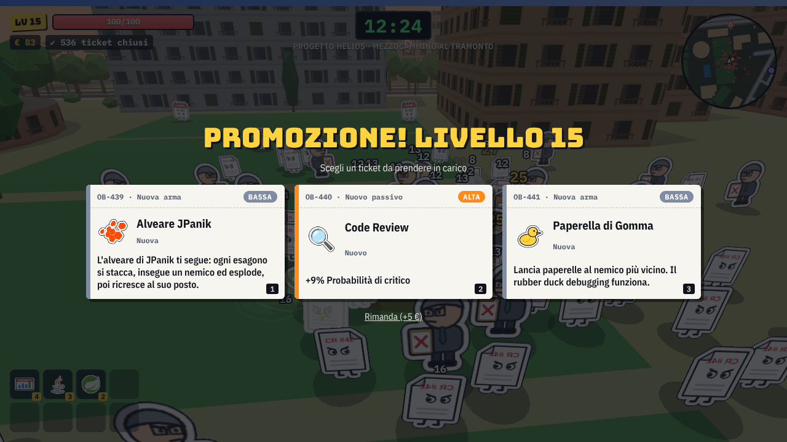</td>
    <td width="50%">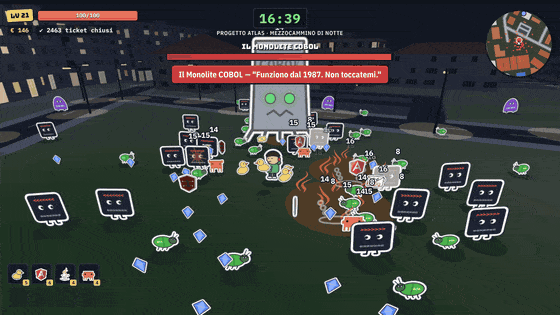</td>
  </tr>
  <tr>
    <td align="center"><b>Promozione</b><br><sub>1 carta-ticket su 3: la priorità è la rarità</sub></td>
    <td align="center"><b>Boss di fine giornata</b><br><sub>Il Monolite COBOL contro gli scudi Angular</sub></td>
  </tr>
  <tr>
    <td width="50%">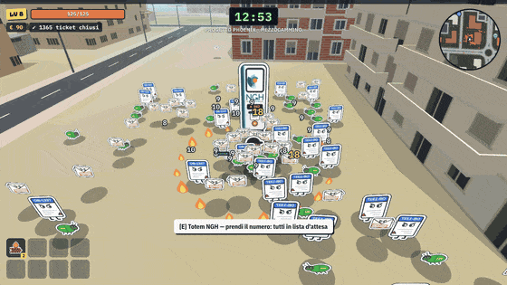</td>
    <td width="50%">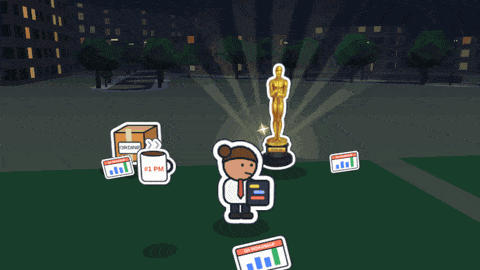</td>
  </tr>
  <tr>
    <td align="center"><b>Totem NGH</b><br><sub>Tutti in lista d'attesa per 6 secondi</sub></td>
    <td align="center"><b>JOscar</b><br><sub>La premiazione dopo il boss</sub></td>
  </tr>
  <tr>
    <td width="50%">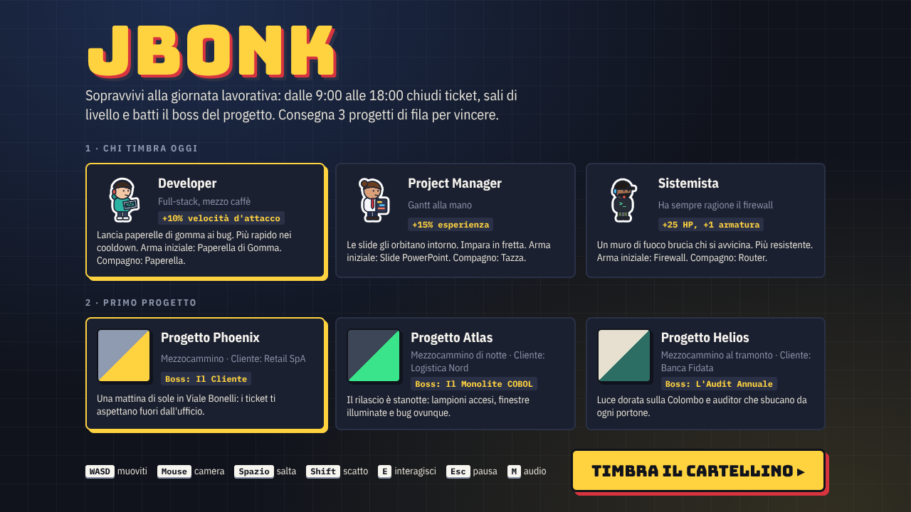</td>
    <td width="50%">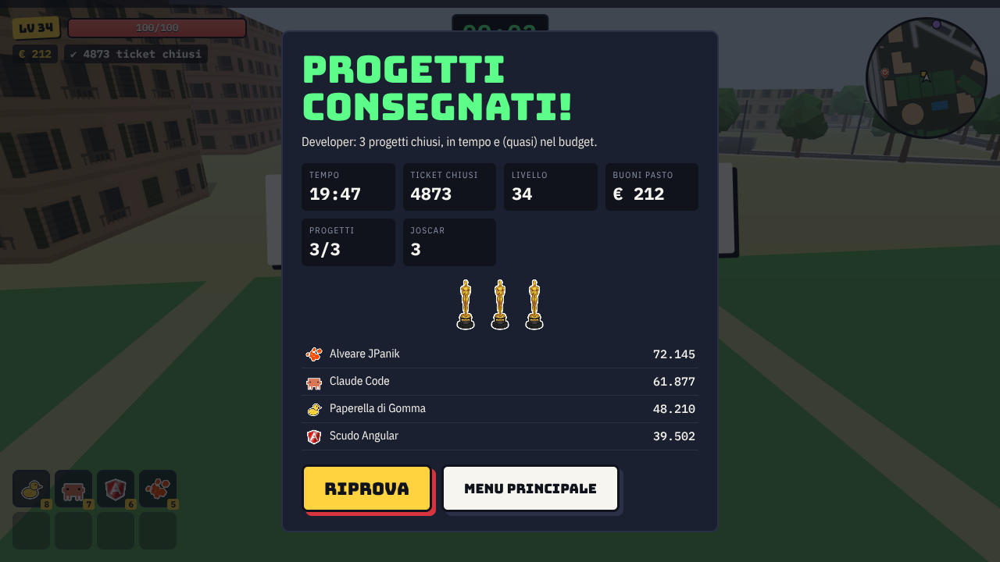</td>
  </tr>
  <tr>
    <td align="center"><b>Si timbra il cartellino</b><br><sub>3 personaggi, 3 progetti</sub></td>
    <td align="center"><b>Progetti consegnati!</b><br><sub>Statistiche, JOscar e danni per arma</sub></td>
  </tr>
</table>

## Architettura

```
src/
  config/            ← DATI: qui si personalizza il gioco senza toccare il motore
    biomes.ts        progetti/biomi (palette, terreno, arredi, nemici, élite, boss)
    enemies.ts       nemici, élite e boss (statistiche + pattern d'attacco dei boss)
    weapons.ts       armi (tipo di comportamento + statistiche + upgrade possibili)
    passives.ts      passivi ("tomi") e bevande della macchinetta
    characters.ts    personaggi giocabili, compagno, arma iniziale, bonus
    tuning.ts        bilanciamento globale (durata giornata, spawn, curva XP, rarità)
  assets/            immagini dei loghi raster, già ritagliate (Java e MongoDB scomposti in parti, Soldo, Spring, scritta NGH, JOscar); JPanik è ridisegnato in vettoriale
  render/
    atlas.ts         sprite disegnati via codice in un'unica texture (stile sagoma di cartone), anche animati
    logos/           sprite animati dai loghi di tecnologie, clienti e premi: un file per logo, elenco in index.ts
    draw.ts          primitive di disegno condivise
    billboards.ts    TUTTI gli sprite in 1 draw call (quad istanziati rivolti alla camera) + ombre
    world.ts         interfaccia del mondo (GameWorld) e arena procedurale: colline, piastrelle, muri, arredi
    city.ts          mappe reali: terreno a strati, edifici estrusi, alberi, lampioni, insegne, collisioni, minimappa
    props.ts         arredi low-poly fatti con primitive (scrivanie, rack, colonne…)
  maps/              mappe reali generate da scripts/map/build_map.py (mezzocammino.json) e il loro formato
  game/
    game.ts          stato della partita e loop: player, nemici, director delle ondate, boss, pickup, interattivi
    weapons.ts       11 pattern d'arma: projectile, orbit, aura, radial, strike, chain, minion, lob, boomerang, split, swarm
    cards.ts         generazione carte (level-up, forziere, caffè) e rarità
    nav.ts           griglia di navigazione: i nemici aggirano i palazzi (campo di flusso dal giocatore)
    camera.ts, input.ts, spatial.ts (griglia per le collisioni), audio.ts (suoni sintetizzati)
  ui/                HUD, minimappa, numeri di danno, schermate (titolo, carte, pausa, fine partita)
    touch.ts         controlli touch (joystick, camera, pulsanti): scrivono in game/input.ts come tasti e mouse
```

Scelte tecniche:
- **Three.js + TypeScript + Vite**, senza motore fisico: collisioni a cerchi su una griglia spaziale, terreno ad altezza analitica.
- **2.5D**: mondo 3D low-poly, personaggi come sprite 2D "in piedi" (billboard cilindrici) con ombra a disco.
- **Prestazioni**: la logica con 280 nemici e 5 armi costa circa **0,7 ms per frame** (misurato). Tutti gli sprite stanno in una sola draw call.
- **Niente asset esterni**: sprite su canvas, arredi da primitive, effetti sonori in WebAudio. Le immagini dei loghi raster sono incluse nel bundle come data URL. Il bundle è un solo file JS (~810 KB, ~285 KB gzip).

## La mappa: Mezzocammino (Roma)

Per ora c'è una sola mappa: il quartiere reale intorno alla sede JPanik, **Viale Gianluigi Bonelli 40**.
Strade, marciapiedi, edifici (con le altezze vere), parchi, campi sportivi, piscine, fermate dell'autobus e
strisce pedonali vengono da [Overture Maps](https://overturemaps.org) (dati © OpenStreetMap contributors, ODbL).
Scala: 1 metro = 0,8 unità di gioco. I tre progetti si svolgono tutti lì e cambiano nemici, boss e luce
(mattina, notte con finestre e lampioni accesi, tramonto).

<table>
  <tr>
    <td width="33%">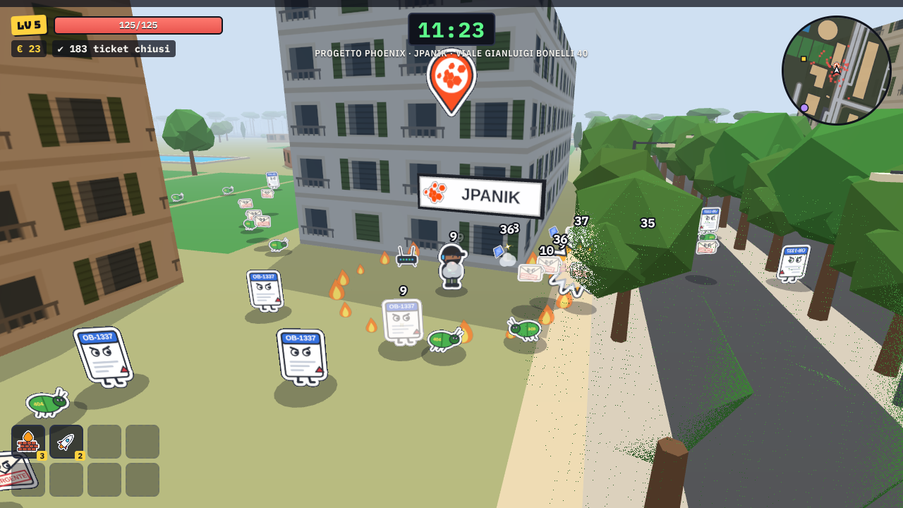</td>
    <td width="33%">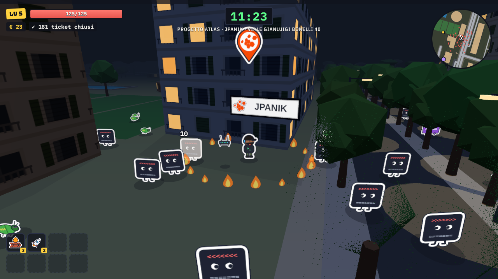</td>
    <td width="33%">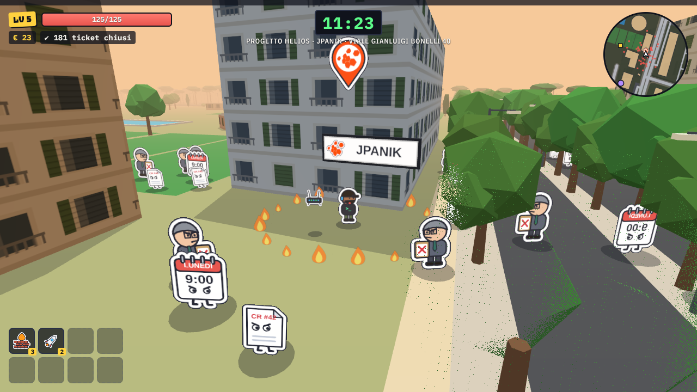</td>
  </tr>
  <tr>
    <td align="center"><b>Progetto Phoenix</b><br><sub>Mattina · boss: Il Cliente</sub></td>
    <td align="center"><b>Progetto Atlas</b><br><sub>Notte · boss: Il Monolite COBOL</sub></td>
    <td align="center"><b>Progetto Helios</b><br><sub>Tramonto · boss: L'Audit Annuale</sub></td>
  </tr>
</table>

<table>
  <tr>
    <td width="50%">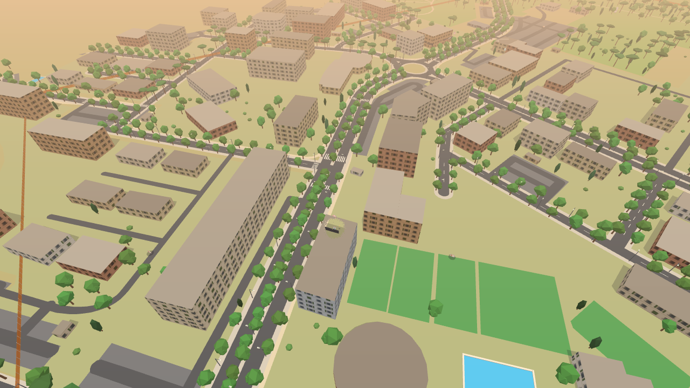</td>
    <td width="50%">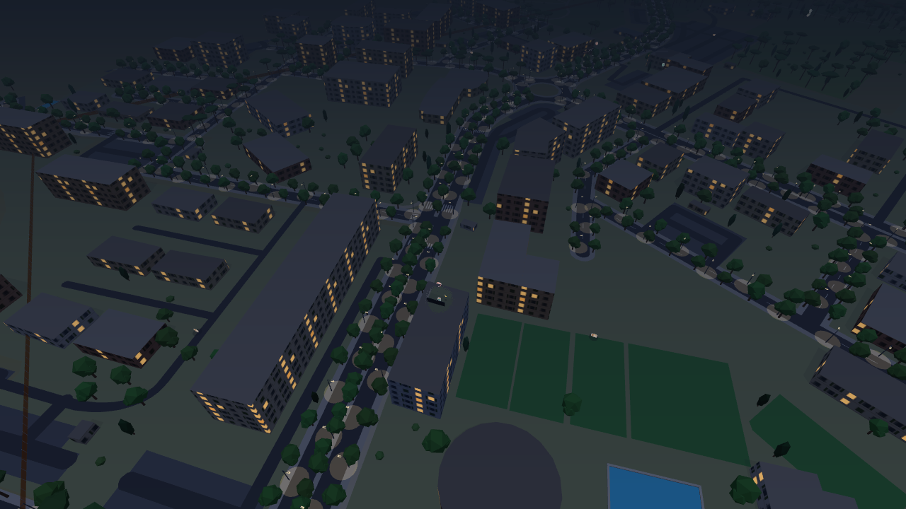</td>
  </tr>
  <tr>
    <td align="center" colspan="2"><sub>Il quartiere visto dall'alto: la sede JPanik è il palazzo grigio al centro, accanto ai campi sportivi</sub></td>
  </tr>
</table>

Punti di interesse, nella posizione reale:

| Locale | Indirizzo | Nel gioco |
|---|---|---|
| JPanik | Viale Gianluigi Bonelli 40 | si parte davanti all'ingresso |
| Konan Sushi | Viale Gianluigi Bonelli 219 | pausa pranzo (cura il 50% degli HP, una volta al giorno) |
| Alberto's Pizza | Viale Gianluigi Bonelli 239 | pausa pranzo |
| Jungle Pokè | Largo Attilio Mussino 9 | pausa pranzo |
| Ami Pokè | Viale Bartolomeo Cavaceppi 18 | pausa pranzo |
| Barcode | Via Vico Consorti 220 | pausa caffè (bonus permanente) |
| Enjoy Sporting Club | Via Cristoforo Colombo 1800 | pausa caffè al bar dello sporting |
| Bar Colombo | Viale Bartolomeo Cavaceppi 103 | pausa caffè |

Altre insegne del quartiere: Pasticceria Positano, Nomisan, Pad Thai Kung, Manifattura Mare e Miscele, Inforno,
Edicola Batman, Farmacia Mezzocammino, Ferramenta, Distributore IP, Climbing Side, Pandolce, Pizza & More,
Tabacchi, Gustus, Numero 10, BCC e il Parco Corto Maltese. I locali principali hanno un segnaposto sopra
l'ingresso e sulla minimappa; l'HUD mostra la via in cui ti trovi o il locale davanti a cui sei.

I palazzi bloccano il passaggio: i nemici li aggirano con una griglia di navigazione (`game/nav.ts`) e la camera
"buca" ciò che sta tra lei e il giocatore. Il confine dell'area di gioco è una rete arancione da cantiere.

**Rigenerare la mappa** (serve Python 3; i dati scaricati restano in `scripts/map/.cache`):

```bash
pip install -r scripts/map/requirements.txt
python scripts/map/build_map.py --fetch   # la prima volta: scarica i dati Overture della zona
python scripts/map/build_map.py           # rigenera src/maps/mezzocammino.json
```

In `build_map.py` si cambiano area e scala (`CENTER_M`, `HALF_M`, `SCALE`) e la lista dei locali (`POIS`, con
ruolo: `start`, `lunch`, `coffee`, `sign`). Il rendering è in `render/city.ts`, il formato dei dati in `maps/types.ts`.

## Come aggiungere un progetto (bioma)

1. In `src/config/biomes.ts` aggiungi un oggetto `BiomeDef` con:
   - `project`, `place`, `client`, `description`;
   - `palette` (colori di pavimento, colline, cielo, nebbia, muri, accento);
   - `terrain` (`amplitude` = altezza delle colline, `frequency` = quanto sono fitte, `tile` = misura delle piastrelle);
   - `props`: quali arredi e quanti (i tipi sono in `PropType`; per uno nuovo aggiungi un `case` in `render/props.ts`);
   - `enemies`: quali nemici, da che secondo compaiono e con che peso;
   - `elite`, `boss`, `swarm`, `swarmName`.
2. Se servono nemici o boss nuovi, aggiungili in `src/config/enemies.ts`. Per il boss compila anche `boss: { shotEvery, shots, shotSpeed, chargeEvery, projectile, quote }`.
3. Per gli sprite nuovi aggiungi una voce in `sprites` dentro `render/atlas.ts` (una funzione che disegna su canvas). Nella versione finale si sostituisce con il caricamento di PNG/spritesheet: il resto del codice usa solo l'id dello sprite. L'atlas cresce in altezza da solo (fino a 2048×4096).

## Sprite animati e loghi

<p align="center">
  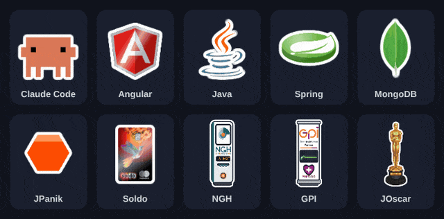
</p>

<table>
  <tr>
    <td align="center" width="33%">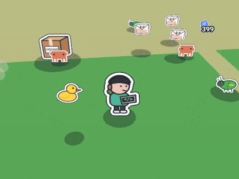<br><b>Claude Code</b><br><sub>subagenti che corrono dai nemici</sub></td>
    <td align="center" width="33%">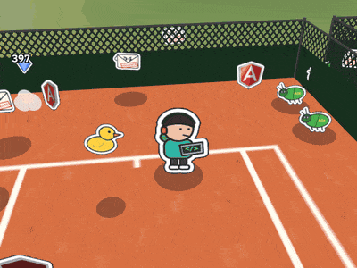<br><b>Scudo Angular</b><br><sub>scudi in orbita, bloccano i proiettili</sub></td>
    <td align="center" width="33%">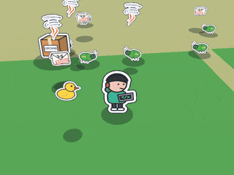<br><b>Tazza di Java</b><br><sub>pozze di caffè ustionante</sub></td>
  </tr>
  <tr>
    <td align="center">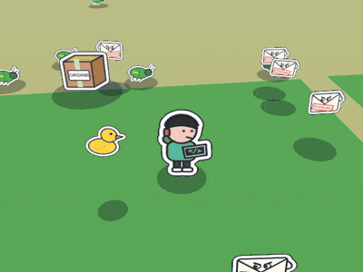<br><b>Spring Boot</b><br><sub>il frisbee che va e torna</sub></td>
    <td align="center">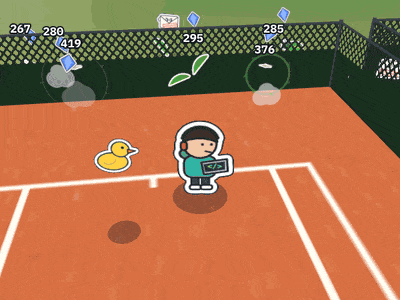<br><b>Foglia di MongoDB</b><br><sub>si divide in shard all'impatto</sub></td>
    <td align="center">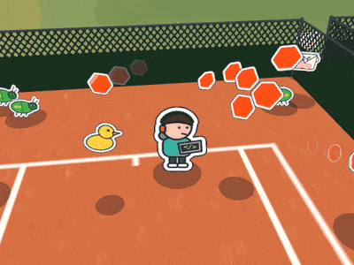<br><b>Alveare JPanik</b><br><sub>gli esagoni inseguono ed esplodono</sub></td>
  </tr>
</table>

- Uno sprite con `frames: n` viene disegnato `n` volte: la funzione di disegno riceve il numero del fotogramma (`i`, da 0 a `n-1`) e ogni fotogramma occupa una cella dell'atlas. Nel gioco `game.anim(id)` restituisce tutti i fotogrammi, `game.frame(id)` il primo (usato anche per le icone).
- I loghi sono in `render/logos/`, un file per logo:
  - **Claude Code**: la mascotte in pixel art, con camminata (4 fotogrammi), riposo con battito di ciglia, attacco a salto e il simbolo di Claude come effetto dei colpi. È l'arma *Claude Code*: aiutanti che corrono dai nemici (i "subagenti" arrivano salendo di livello).
  - **Angular**: lo scudo ricostruito dai path SVG ufficiali, che ruota su se stesso in 16 fotogrammi (spessore del bordo, retro con le cinghie, riflesso). È l'arma *Scudo Angular*: scudi in orbita che bloccano anche i proiettili dei boss.
  - **Java**: dall'immagine originale, scomposta in parti (`assets/java-parts.webp`). Il vapore ondeggia riga per riga, gli anelli della tazza rimbalzano in sequenza. È l'arma *Tazza di Java*: tazze lanciate a parabola che lasciano una pozza di caffè ustionante, con il vapore del logo che sale.
  - **GPI**: il logo ricostruito in vettoriale su un roll-up, con il puntino della *i* che saltella, il tracciato ECG e il cuore che batte. È il *Presidio GPI* che cura.
  - **Soldo**: la carta originale (`assets/soldo-card.webp`) che gira in prospettiva, con il retro disegnato e un riflesso. È la *Carta Soldo* che ricarica il budget.
  - **Spring**: il logo originale (`assets/spring.webp`) su un disco visto in prospettiva che gira, con lo spessore del bordo e un riflesso fisso. È l'arma *Spring Boot*: un frisbee che va, attraversa i nemici e torna.
  - **MongoDB**: la foglia originale divisa lungo la nervatura in due metà e gambo (`assets/mongo-leaf.webp`). In volo si ribalta e mostra il rovescio più chiaro; all'impatto le metà si separano. È l'arma *Foglia di MongoDB*: le metà diventano shard che colpiscono i nemici vicini.
  - **JPanik**: gli 8 esagoni del logo misurati sull'originale e ridisegnati, ognuno anche come sprite a sé. È l'arma *Alveare JPanik*: un alveare con la forma del logo segue il giocatore, gli esagoni si staccano (prismi che si ribaltano in volo), inseguono i nemici, esplodono e ricrescono al loro posto.
  - **NGH · NextGenerationHIS**: il simbolo del logo ridisegnato in vettoriale (lo spicchio gira come il fascio di un radar, con la scia e i "bip") e la scritta originale (`assets/ngh-text.webp`), su un totem eliminacode che stampa i numeri. È il *Totem NGH*: i nemici in attesa diventano verde acqua e tengono in mano il loro biglietto.
  - **JOscar**: la statuetta originale (`assets/joscar.webp`, oro e base separati) con un riflesso che scorre solo sull'oro e la targhetta "JOSCAR" sulla base. Intorno: fasci di luce da palco, scintille e coriandoli per la premiazione.
- Per aggiungere un logo: crea un file in `render/logos/` che esporta i suoi `SpriteDef` e aggiungilo all'elenco in `logos/index.ts`. Se è raster, metti l'immagine in `src/assets` e registrala in `logos/images.ts`, poi disegnala con `images.get(...)`. Per i loghi vettoriali basta ridisegnarli su canvas (con `Path2D` si possono usare direttamente i path SVG).

## Come aggiungere un'arma o un passivo

- **Arma**: in `config/weapons.ts` scegli un `kind` tra `projectile | orbit | aura | radial | strike | chain | minion | lob | boomerang | split | swarm`, poi imposta statistiche base e upgrade. Un comportamento nuovo va aggiunto in `game/weapons.ts`. Alcuni tipi cercano sprite con suffissi fissi: `minion` (`_idle`, `_hit`, `_spark`), `lob` (`_splash`, `_steam`), `split` (`_l`, `_r`, `_stem`, `_burst`; `pierce` è il numero di shard), `swarm` (celle `_c0`…, `_fly`, `_burst`, più la disposizione dell'alveare in `HIVES` dentro `logos/index.ts`).
- **Passivo**: in `config/passives.ts` indica la statistica (`stat`), il valore per livello e il formato.

## Screenshot e GIF del README

Le immagini in `docs/media/` sono catturate dal gioco vero con `scripts/readme-media/capture.mjs` (Playwright).
Il browser gira con un orologio virtuale: ogni fotogramma fa avanzare la partita di un passo fisso, quindi le GIF
restano fluide anche dove il rendering è lento (headless, senza GPU). Le scene preparano la situazione da sole:
personaggio, armi, posizione sulla mappa, nemici, boss.

```bash
npm run dev                                                     # in un altro terminale
npm i --no-save playwright && npx playwright install chromium   # la prima volta
node scripts/readme-media/capture.mjs                           # tutte le scene
node scripts/readme-media/capture.mjs hero weapons              # solo alcune
```

Scene: `banner`, `title`, `hero`, `levelup`, `biomes`, `aerial`, `boss`, `weapons`, `ngh`, `joscar`, `victory`, `mobile`, `sprites`.
Serve `ffmpeg`; se c'è anche `gifsicle` (nel PATH o in `$GIFSICLE`) le GIF pesano circa un terzo in meno.

## Limiti noti del POC

- Grafica segnaposto: sprite vettoriali ed emoji per le icone dei passivi (su Linux senza font emoji compaiono quadratini).
- Tastiera e mouse o touch: niente gamepad. I controlli touch sono provati in emulazione (Chromium), vanno rifiniti su telefoni veri.
- Niente salvataggi di progressione, sblocchi o classifica. Si memorizza solo la scelta di personaggio e progetto (localStorage).
- Bilanciamento verificato solo con un bot in simulazione: va rifinito giocando.

## Prossimi passi suggeriti

1. Playtest interno e taratura di `tuning.ts` e delle armi.
2. Pipeline grafica: spritesheet PNG (Aseprite) caricate nell'atlas, con 2–4 fotogrammi di animazione.
3. I progetti reali in `biomes.ts`, con nemici e boss a tema.
4. Classifica aziendale (piccolo backend, es. Supabase o Node+SQLite in intranet) e sblocchi tra una partita e l'altra.
5. Gamepad, musica, menu opzioni (sensibilità di mouse e touch, volume).
